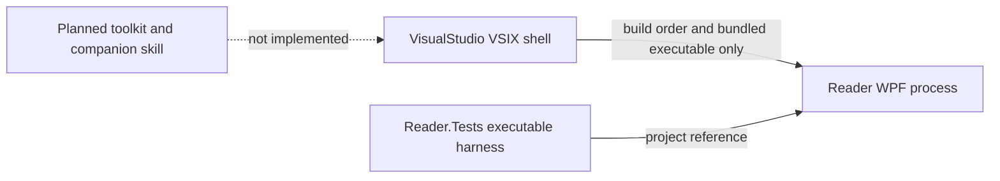

# Code summary

VsCopilotChatVoice is an independent Visual Studio Copilot Chat voice integration under
development. Its .NET Framework 4.8 solution contains a thin AsyncPackage VSIX, a separate
x64 WPF/System.Speech reader, and an executable reader regression harness.

## Components

The 0.2.3 VSIX previews three disabled, flat toolbar icons beside Customize AI inside one
themed border, using conservative WPF discovery. It does not launch the reader or provide a
command bridge. Initial 0.2.0 attachment was verified; the user confirmed grouped icons look
fine and approved the tighter 24-DIP group-height correction in Exp. The full native
theme/DPI/accessibility and chat-recreation matrix remains pending.
No VoiceType source or engine/model assets have been copied.
The reader retains prototype branding and a pale-yellow palette.
Phase 2 part 1 moves its speech-free document/navigation/preference types into
`src\Shared\ReaderDocument.cs`, compiled into Reader and VSIX. Their public names/behavior and
standalone assembly identity remain unchanged; the speech-owning ReaderWindow/CLI stay external.
The native PoC view still uses its original sample; migrated playback/presentation remain pending.
Actual built/installed model checks pass 379 assertions; all seven earlier routes and the targeted
independent audit pass. Exp 0.4.1 package/metadata loading and clean graceful shutdown are verified,
not migrated reader/layout/playback acceptance.

The 0.2.12 PoC build retains that toolbar appearance and adds `ChatBridgePoc`, explicitly
gated to Debug + Exp + launch environment opt-in. Its current-user-only named pipe defaults to inspecting
live WPF metadata through observed Session/Composer/ChatLog and composer-input/action paths,
plus inspected typed session-ID fields and passive draft-revision/trust/responding observation;
an additional launch gate accepts insertion-capability requests through `ChatDraftPoc` but always
refuses unproved native atomic editing. The unfenced draft getter/setter transaction was removed.
It cannot send or deliver replies. Production plans in
IMPLEMENTATION_PLAN.md supersede optional-VoiceType-app discovery with selective external-host
source reuse and native reader presentation. Capture source reuse and full reader-feature migration
are still planned; the native presentation preview is implemented below.

The 0.3.0 PoC 2 build adds a native floating tool window (View > Other Windows > Copilot Voice
Reader (Preview)) with an external headless speech worker. devenv hosts presentation only; the worker
is the bundled `VsCopilotChatVoice.Reader.exe --speech-worker <pipe>`, talking JSON lines over a
current-user-only named pipe. The shared protocol/host files in `src\Shared` are compiled into the
VSIX, the Reader and the test project. This is a preview proof, not the production reader.

The 0.3.2 PoC 3 build adds a Debug/Exp/environment-gated log-only `ChatGesturePoc`, a pure
Ctrl gesture state machine and a same-user/session nonblocking recording mutex. The observer
shares the toolbar's verified picker, attaches to the nearest chat panel and queues fake
capture acknowledgements. It never handles input, opens a microphone, edits or sends. Physical
Right Ctrl proof remains unavailable; ordinary Ctrl shortcuts passed live in Exp.
Release-side invalidation and Ctrl-up held-input checks guard native shortcut key-down suppression;
Escape up also cancels. Patched physical Toggle/shortcut/Escape-release passed in Exp;
two live Exp instances proved focus-cancelled ownership handoff and reacquisition. The bounded
result is accepted with release-side adaptation; microphone/production input remains unimplemented.

## Structural symbols

The 0.4.0 Phase 1 foundation adds a separately gated metadata-only endpoint. `ChatMetadataBridge`
reuses conservative discovery and extracted exact native binding capture, tracking one observation
epoch per supported chat anchor. Shared typed requests/targets/responses and the server/client handle
current-user, kernel-peer-checked discovery and per-connection correlation/lifetime fences. No draft,
reply, editing, send or microphone is exposed. The approved ambiguity-recovery fix and stronger
negative tests passed independent audit closure. Native instance checks passed; conversation-target
status and epoch retirement/recreation passed on the first populated SDK chat. Acceptance remains
metadata-only: two live SDK chats, cross-instance isolation and graceful shutdown are now verified.
Blank/history-only surfaces without a live supported binding still expose no target.

### VsCopilotChatVoice.VisualStudio

| Symbol | File | Responsibility |
| --- | --- | --- |
| `VsCopilotChatVoice.VisualStudio.VoicePackage` | `src\VsCopilotChatVoice.VisualStudio\VoicePackage.cs` | Background-loadable package; owns/disposes toolbar and gated bridge/gesture observers; provides tool-window creation, dynamic VS resources and activity logging. |
| `ChatToolbarIntegration` | `src\VsCopilotChatVoice.VisualStudio\ChatToolbarIntegration.cs` | Bounded visible-picker discovery, conservative placement, disabled accessible controls, duplicate/lifetime handling; no speech or SDK dependencies. |
| `ChatBridgePoc` | `src\VsCopilotChatVoice.VisualStudio\ChatBridgePoc.cs` | Opt-in Exp pipe, bounded native target discovery and separately gated atomic-insertion capability refusal. No draft mutation or send/reply protocol. |
| `ChatTargetObservation` | `src\VsCopilotChatVoice.VisualStudio\ChatTargetObservation.cs` | Passive native-target epoch and draft-notification counter, trust/responding streams, automatic terminal teardown and primitive diagnostic retention. Does not read/write a draft or invoke commands. |
| `ChatDraftPoc` | `src\VsCopilotChatVoice.VisualStudio\ChatDraftPoc.cs` | Explicit unsupported-atomic-edit refusal, bounded request validation, cancellation, non-evicting request deduplication and immutable-slot metadata checks; no draft access or send. |
| `ChatGesturePoc` | `src\VsCopilotChatVoice.VisualStudio\ChatGesturePoc.cs` | Gated chat-root preview-event observer, focus/lifetime cancellation, counters/decisions, fake asynchronous readiness/stop/result and thread-affine mutex adapter. No audio or delivery. |
| `ChatMetadataBridge` | `src\VsCopilotChatVoice.VisualStudio\ChatMetadataBridge.cs` | Gated metadata endpoint adapter; composite native identity/epoch capture, per-anchor passive observation, UI-thread retirement and package disposal. |

| `ReaderToolWindow` | `src\VsCopilotChatVoice.VisualStudio\ReaderToolWindow.cs` | `ToolWindowPane` registered `Style=Float`; hosts the control and disposes it. |
| `ReaderToolWindowControl` | `src\VsCopilotChatVoice.VisualStudio\ReaderToolWindowControl.cs` | Code-built WPF: Speak/Cancel, status, sample reply, VS-themed word highlight, lazy worker launch, UI-thread generation guard. No speech in-process. |
| `VoiceCommands.vsct` | `src\VsCopilotChatVoice.VisualStudio\VoiceCommands.vsct` | View > Other Windows menu command that shows the tool window. |

### Shared (compiled into VSIX, Reader and Tests)

| Symbol | File | Responsibility |
| --- | --- | --- |
| `SpeechWorkerProtocol` / `WorkerMessage` / `BoundedLineReader` / `ReplyText` | `src\Shared\SpeechWorkerProtocol.cs` | Message DTO, size limits, strict parser, bounded line reader and the word/offset model. |
| `SpeechWorkerHost` | `src\Shared\SpeechWorkerHost.cs` | Pipe server, async serialized bounded writes, worker PID check, generation/command-correlated state, cancellation epochs fencing queued starts, cancellable launch/connect and teardown; legacy Cancel exception compatibility preserved. |

Gesture sources are compiled into VSIX and Tests only:

Metadata contracts/server and `PipePeerIdentity` are also compiled into VSIX/Tests; only the
bounded speech/framing and shared reader model sources are compiled into the Reader. `ChatBridgeContracts.cs` defines
`BridgeRequest`, `BridgeTarget`, `BridgeResponse` and strict bounded schema parsing;
`ChatMetadataServer.cs` defines the owned endpoint and read-only peer/lifetime-verifying client.
`PipePeerIdentity.cs` shares current-user pipe ACL and safe-handle kernel peer checks with speech.

| Symbol | File | Responsibility |
| --- | --- | --- |
| `CtrlGestureDetector` / `GestureDecision` | `src\Shared\CtrlGestureDetector.cs` | Serialized pure Hold/Toggle state machine, configurable Ctrl side, tentative gestures, startup races and cancellation/late-result fencing. |
| `RecordingOwnership` / `OwnershipResult` | `src\Shared\RecordingOwnership.cs` | Current-user ACL-restricted Local mutex, nonblocking ownership, abandonment reporting, local recursive-acquire refusal and thread-affine release/disposal. |

### VsCopilotChatVoice.Reader

All reader symbols retain the `ReadAlongTrial` namespace. The document/navigation/preference
symbols now live in `src\Shared\ReaderDocument.cs` and are also compiled into VSIX; the table's
ReaderPrototype locations below apply only to Program/ReaderWindow.

| Symbol | File | Responsibility |
| --- | --- | --- |
| `Program` | `src\VsCopilotChatVoice.Reader\ReaderPrototype.cs` | STA entry point, ordered CLI validation, live owner HWND validation, self-tests. |
| `ReaderWindow` | `src\VsCopilotChatVoice.Reader\ReaderPrototype.cs` | Reader UI, playback lifetime, highlighting, Follow and version switching. |
| `DocumentBuilder` / `ReplyBlock` | `src\Shared\ReaderDocument.cs` | JSON block validation, display/spoken document construction and cross-version section matching. |
| `ReadingNavigation` / `ReadingPosition` | `src\Shared\ReaderDocument.cs` | Sentence/paragraph movement and text-pointer seeking. |
| `Segment` / `WordAnchor` | `src\Shared\ReaderDocument.cs` | Section identity and spoken-offset-to-display mapping. |
| `ReplyVersionPreference` | `src\Shared\ReaderDocument.cs` | Immediate, atomic Concise/Detailed preference persistence. |
| `SpeechWorker` | `src\VsCopilotChatVoice.Reader\SpeechWorker.cs` | Headless pipe client (`--speech-worker <pipe> [--silent]`): owns synthesis, real prompt-preserving pause/resume and correlated state acknowledgements; reports progress and ignores superseded prompts. |

### VsCopilotChatVoice.Reader.Tests

| Symbol | File | Responsibility |
| --- | --- | --- |
| `ReadAlongNavigationTests` | `tests\VsCopilotChatVoice.Reader.Tests\ReaderRegressionTests.cs` | Executable WPF/navigation/preference/ownership and child-process regression checks; no Test Explorer adapter. |
| `ToolbarRegressionTests` | `tests\VsCopilotChatVoice.Reader.Tests\ToolbarRegressionTests.cs` | Optional reflection-based checks against the actual VSIX toolbar class using offscreen synthetic WPF chat controls; no speech/preferences. |
| `BridgePocRegressionTests` | `tests\VsCopilotChatVoice.Reader.Tests\BridgePocRegressionTests.cs` | Optional actual-VSIX checks for gating, metadata, public/interface identity fields, private/content getter exclusion and hidden windows, plus isolated real-listener timeout/recovery/shutdown checks. No VS input/speech/preferences. |
| `SpeechWorkerRegressionTests` | `tests\VsCopilotChatVoice.Reader.Tests\SpeechWorkerRegressionTests.cs` | `--speech-worker-probe`: 104 protocol/model/fake-peer/real silent-worker assertions, correlated state, raw pause silence/resume, deadlines, cancelled/late startup, queued-start cancellation, legacy timeout compatibility and disposal. Independent targeted audit closure passes. |
| `GestureRegressionTests` | `tests\VsCopilotChatVoice.Reader.Tests\GestureRegressionTests.cs` | `--gesture-probe [VSIX-DLL]`: pure/fake lifecycle including suppressed key-down and both release orders, real two-process contention/abandonment and actual-DLL WPF observer; 196 / 209 assertions. Isolated mutex names; no microphone. |
| `ContractRegressionTests` | `tests\VsCopilotChatVoice.Reader.Tests\ContractRegressionTests.cs` | `--contracts-probe [VSIX-DLL]`: schema/framing, lifetime/target/order/replay guards, real peer/process isolation, cancellation/late-provider, ambiguity recovery, capacity and acknowledgement tests plus DLL gates; 131 / 136 assertions. `--metadata-inspect` and exact-target `--metadata-status` are read-only. |
| `ReaderModelRegressionTests` | `tests\VsCopilotChatVoice.Reader.Tests\ReaderModelRegressionTests.cs` | `--reader-model-probe <VSIX-DLL>`: 379 actual shared type ownership/dependency, document parity, step/word/sentence navigation, malformed-variant and isolated interoperable-preference assertions. |
| `DraftPocRegressionTests` | `tests\VsCopilotChatVoice.Reader.Tests\DraftPocRegressionTests.cs` | Actual-VSIX mutation-surface removal, capability refusal, validation, cancellation, deduplication/conflicts/capacity and immutable-slot checks; no live VS input. |

See `docs/KEY_FLOWS.md` for traced end-to-end call flows.

Build/test commands, reply data contract and verified Exp installation steps are in `README.md`.