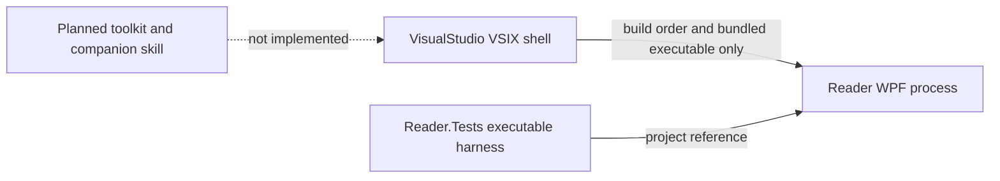

# Code summary

VsCopilotChatVoice is an independent Visual Studio Copilot Chat voice integration under
development. Its .NET Framework 4.8 solution contains a thin AsyncPackage VSIX, a separate
x64 WPF/System.Speech reader, and an executable reader regression harness.

## Components

The 0.2.3 VSIX previews three disabled, flat toolbar icons beside Customize AI inside one
themed border, using conservative WPF discovery. It does not launch the reader or provide a
command bridge. Initial 0.2.0 attachment was verified; the user confirmed grouped icons look
fine and approved the tighter 24-DIP group-height correction in Exp. The full native
theme/DPI/accessibility and chat-recreation matrix remains pending.
No VoiceType source or engine/model assets have been copied.
The reader retains prototype branding and a pale-yellow palette.
Phase 2 part 1 moves its speech-free document/navigation/preference types into
`src\Shared\ReaderDocument.cs`, compiled into Reader and VSIX. Their public names/behavior and
standalone assembly identity remain unchanged; the speech-owning ReaderWindow/CLI stay external.
The ungated native PoC view still uses its original sample. The 0.4.3 audited single-reply playback
controller/typed external-worker adapter are wired only into the 0.4.8 Debug/Exp/launch-gated native
prepared-pair view. Native frame/layout/focus/theme acceptance remains pending. The owner separates
reply/version/operation and speech-generation lifetimes,
dispatcher-bound selection/state, true acknowledged pause/resume and bounded event coalescing.
It has no preference-file, scrolling, activation or focus side effects; typed dispatcher change/task
notifications support presentation without polling. Prompt/version/operation revalidation fences synchronous
notification reentrancy before completion/seek restart/state commands/accepted Ready. NativeReaderView loads/saves through the shared
preference model, displays failure/missing-version notices and preserves silent open/paused switching;
its post-notification continuations preserve newer explicit choices and close/disposal intent.
Displayed status/warning Text binds to stable-ID accessible Names with polite live settings. A small
private VersionChoice RadioButton subtype marks only originating native/model Checked events, consuming
their origin before RadioButton group callbacks. A monotonic request revision captured before OnClick
fences superseded native Click and same-version saves; genuine same-mode peers persist immediately.
Nested peer/Click choices remain synchronous with inherited WPF automation/style/focus and no auto speech.
View disposal retires intent before owner shutdown; scoped Esc now includes owned buttons/radios while
leaving their other keys and dropdown/edit/scrollbar/slider native handling untouched.
ReaderFrameLifecycle adds an owned Advise sink without replacing frame helpers; close requests Stop,
whereas docking/visibility/unload do not change playback lifetime. No new preference schema is added.
Actual built/installed model checks pass 379 assertions; all seven earlier routes and the targeted
independent audit pass. Exp 0.4.1 package/metadata loading and clean graceful shutdown are verified,
not migrated reader/layout/playback acceptance.

The 0.2.12 PoC build retains that toolbar appearance and adds `ChatBridgePoc`, explicitly
gated to Debug + Exp + launch environment opt-in. Its current-user-only named pipe defaults to inspecting
live WPF metadata through observed Session/Composer/ChatLog and composer-input/action paths,
plus inspected typed session-ID fields and passive draft-revision/trust/responding observation;
an additional launch gate accepts insertion-capability requests through `ChatDraftPoc` but always
refuses unproved native atomic editing. The unfenced draft getter/setter transaction was removed.
It cannot send or deliver replies. Production plans in
IMPLEMENTATION_PLAN.md supersede optional-VoiceType-app discovery with selective external-host
source reuse and native reader presentation. Capture source reuse and full reader-feature migration
are still planned; the native presentation preview is implemented below.

The 0.3.0 PoC 2 build adds a native floating tool window (View > Other Windows > Copilot Voice
Reader (Preview)) with an external headless speech worker. devenv hosts presentation only; the worker
is the bundled `VsCopilotChatVoice.Reader.exe --speech-worker <pipe>`, talking JSON lines over a
current-user-only named pipe. The shared protocol/host files in `src\Shared` are compiled into the
VSIX, the Reader and the test project. This is a preview proof, not the production reader.

The 0.3.2 PoC 3 build adds a Debug/Exp/environment-gated log-only `ChatGesturePoc`, a pure
Ctrl gesture state machine and a same-user/session nonblocking recording mutex. The observer
shares the toolbar's verified picker, attaches to the nearest chat panel and queues fake
capture acknowledgements. It never handles input, opens a microphone, edits or sends. Physical
Right Ctrl proof remains unavailable; ordinary Ctrl shortcuts passed live in Exp.
Release-side invalidation and Ctrl-up held-input checks guard native shortcut key-down suppression;
Escape up also cancels. Patched physical Toggle/shortcut/Escape-release passed in Exp;
two live Exp instances proved focus-cancelled ownership handoff and reacquisition. The bounded
result is accepted with release-side adaptation; microphone/production input remains unimplemented.

## Structural symbols

The 0.4.0 Phase 1 foundation adds a separately gated metadata-only endpoint. `ChatMetadataBridge`
reuses conservative discovery and extracted exact native binding capture, tracking one observation
epoch per supported chat anchor. Shared typed requests/targets/responses and the server/client handle
current-user, kernel-peer-checked discovery and per-connection correlation/lifetime fences. No draft,
reply, editing, send or microphone is exposed. The approved ambiguity-recovery fix and stronger
negative tests passed independent audit closure. Native instance checks passed; conversation-target
status and epoch retirement/recreation passed on the first populated SDK chat. Acceptance remains
metadata-only: two live SDK chats, cross-instance isolation and graceful shutdown are now verified.
Blank/history-only surfaces without a live supported binding still expose no target.

### VsCopilotChatVoice.VisualStudio

| Symbol | File | Responsibility |
| --- | --- | --- |
| `VsCopilotChatVoice.VisualStudio.VoicePackage` | `src\VsCopilotChatVoice.VisualStudio\VoicePackage.cs` | Background-loadable package; owns/disposes toolbar and gated bridge/gesture observers; provides tool-window creation, dynamic VS resources and activity logging. |
| `ChatToolbarIntegration` | `src\VsCopilotChatVoice.VisualStudio\ChatToolbarIntegration.cs` | Bounded visible-picker discovery, conservative placement, disabled accessible controls, duplicate/lifetime handling; no speech or SDK dependencies. |
| `ChatBridgePoc` | `src\VsCopilotChatVoice.VisualStudio\ChatBridgePoc.cs` | Opt-in Exp pipe, bounded native target discovery and separately gated atomic-insertion capability refusal. No draft mutation or send/reply protocol. |
| `ChatTargetObservation` | `src\VsCopilotChatVoice.VisualStudio\ChatTargetObservation.cs` | Passive native-target epoch and draft-notification counter, trust/responding streams, automatic terminal teardown and primitive diagnostic retention. Does not read/write a draft or invoke commands. |
| `ChatDraftPoc` | `src\VsCopilotChatVoice.VisualStudio\ChatDraftPoc.cs` | Explicit unsupported-atomic-edit refusal, bounded request validation, cancellation, non-evicting request deduplication and immutable-slot metadata checks; no draft access or send. |
| `ChatGesturePoc` | `src\VsCopilotChatVoice.VisualStudio\ChatGesturePoc.cs` | Gated chat-root preview-event observer, focus/lifetime cancellation, counters/decisions, fake asynchronous readiness/stop/result and thread-affine mutex adapter. No audio or delivery. |
| `ChatMetadataBridge` | `src\VsCopilotChatVoice.VisualStudio\ChatMetadataBridge.cs` | Gated metadata endpoint adapter; composite native identity/epoch capture, per-anchor passive observation, UI-thread retirement and package disposal. |
| `SettingsToolWindow` / `SettingsView` | `src\VsCopilotChatVoice.VisualStudio\SettingsToolWindow.cs`, `SettingsView.cs` | Dockable (floating-by-default) tool window hosting the scoped speech/audio/appearance settings view. No Apply button: changes save on change (sliders debounced 400 ms, flushed on dispose/solution change); Reset is the footer button. View is built in the pane constructor (VS reads `Content` before `OnToolWindowCreated`); `VoicePackage` creates the settings store lazily because a persisted window is restored before `InitializeAsync`. Opened from View > Other Windows (`0x0101`), the chat-toolbar gear and the reader header gear (`PostExecCommand`). |
| `VsThemedStyles` | `src\VsCopilotChatVoice.VisualStudio\VsThemedStyles.cs` | Self-contained XAML styles (Button, IconButton, VersionChoice, RadioButton, CheckBox, ComboBox, ComboBoxItem, Slider) driven only by `EnvironmentColors` brush keys; disabled controls dim by opacity; selected/hover/pressed states use an accent `MainWindowActiveDefaultBorder` border (the HoverActive/Down fills are light plates in dark themes, remapped in `Parse`). Used by SettingsView and NativeReaderView; the accent (checkbox, slider, selected Concise/Detailed segment, text highlight) is `MainWindowActiveDefaultBorder`; no dependency on VS-internal themed-dialog styles. |
| `SpeechPreview` | `src\VsCopilotChatVoice.VisualStudio\SpeechPreview.cs` | Settings Preview helper: sends options plus text and waits for the worker's Completed/Faulted (or cancel/timeout) so the host is not torn down at the options acknowledgement. |

| `ReaderToolWindow` | `src\VsCopilotChatVoice.VisualStudio\ReaderToolWindow.cs` | Same float-first ToolWindowPane registration; selects old PoC or gated native view, attaches frame notifications in OnToolWindowCreated and disposes its owned sink/view. VS manages geometry. |
| `ReaderToolWindowControl` | `src\VsCopilotChatVoice.VisualStudio\ReaderToolWindowControl.cs` | Code-built WPF: Speak/Cancel, status, sample reply, VS-themed word highlight, lazy worker launch, UI-thread generation guard. No speech in-process. |
| `NativeReaderPreview` | `src\VsCopilotChatVoice.VisualStudio\NativeReaderPreview.cs` | Strict Debug/Exp/environment gate, labelled five-section paired fixture, gated isolated preference override and repo-standard FileAndForget observation. No reply feed or automatic speech. |
| `NativeReaderView` | `src\VsCopilotChatVoice.VisualStudio\NativeReaderView.cs` | Owning-dispatcher presentation over the audited owner; shared documents/navigation/preferences, native accessible transport/version/Follow, exact word seek, focused-text keyboard scope, wrapping and dynamic VS/system/High Contrast resources. No speech ownership or visibility-disposal coupling. |
| `ReaderFrameLifecycle` | `src\VsCopilotChatVoice.VisualStudio\ReaderFrameLifecycle.cs` | Owned IVsWindowFrame2.Advise subscription implementing Notify/Notify2/Notify3; ref save-options preserved, explicit close Stop observed asynchronously, other frame notifications no-op, exact Unadvise. Missing registration disables Play. Synthetic tests do not prove native close delivery/retention. |
| `ReaderPlaybackController` / `ReaderPlaybackPhase` | `src\VsCopilotChatVoice.VisualStudio\ReaderPlaybackController.cs` | Audited single-reply owner: explicit dispatcher affinity, segment/suffix/word selection, section-ID variant mapping, acknowledged pause/resume, exactly-once completion, bounded early-event coalescing and launch/session/operation teardown fences. Changed and background-task notifications connect only the gated view. |
| `ReaderSpeechBackend` / `IReaderSpeechBackend` / `IReaderSpeechSession` | `src\VsCopilotChatVoice.VisualStudio\ReaderSpeechBackend.cs` | Internal typed test seam and real adapter over SpeechWorkerHost; cancellable external startup, prompt generation and owned session cleanup, without System.Speech or Reader assembly reference. |
| `VoiceCommands.vsct` | `src\VsCopilotChatVoice.VisualStudio\VoiceCommands.vsct` | View > Other Windows menu command that shows the tool window. |

### Shared (compiled into VSIX, Reader and Tests)

| Symbol | File | Responsibility |
| --- | --- | --- |
| `SpeechWorkerProtocol` / `WorkerMessage` / `BoundedLineReader` / `ReplyText` | `src\Shared\SpeechWorkerProtocol.cs` | Message DTO, size limits, strict parser, bounded line reader and the word/offset model. |
| `SpeechWorkerHost` | `src\Shared\SpeechWorkerHost.cs` | Pipe server, async serialized bounded writes, worker PID check, generation/command-correlated state, cancellation epochs fencing queued starts, cancellable launch/connect and teardown; legacy Cancel exception compatibility preserved. |
| `SpeechOptionsSnapshot` / `SpeechOptionsWire` | `src\Shared\SpeechOptions.cs` | Internal sealed immutable speech-free voice/default/rate/volume snapshot and strict schema1 profile codec, linked into Reader/VSIX/Tests. Settings/runtime supplies the effective snapshot; configured-speech Host API/current-generation OptionsApplied event applies it only in the external worker. |
| `SpeechVoiceCapability` / `SpeechCapabilityReport` / `RememberedVoiceAvailability` / `SpeechCapabilities` | `src\Shared\SpeechCapabilities.cs` | Internal speech-free versioned engine/voice/default/bounds DTO, strict bounded UTF8 serialization/parser and explicit remembered-name availability without substitution. Source-linked into Reader/VSIX/Tests. |
| `SpeechCapabilityQuery` | `src\Shared\SpeechCapabilityQuery.cs` | Internal unwired owned-child Reader query; API-entry deadline, dedicated orchestration/bounded drains, pool-independent waits/prelaunch expiry fence and exact-child cleanup. Source-linked into Reader/VSIX/Tests; original queued-deadline finding closed independently. Native synchronous calls remain nonpreemptible. |
| `ReaderBlockValidation` / `TextToken` | `src\Shared\ReaderBlockValidation.cs` | Internal pure header/number/token/readability/section-ID validation extracted without changing legacy order/messages/formatting/offsets; source-linked into Reader/VSIX/Tests and reused by the captured-history model. |

Gesture sources are compiled into VSIX and Tests only:

Metadata contracts/server and `PipePeerIdentity` are also compiled into VSIX/Tests; the
bounded speech/framing, capability contracts/query and shared reader model sources are compiled into the Reader. `ChatBridgeContracts.cs` defines
`BridgeRequest`, `BridgeTarget`, `BridgeResponse` and strict bounded schema parsing;
`ChatMetadataServer.cs` defines the owned endpoint and read-only peer/lifetime-verifying client.
`PipePeerIdentity.cs` shares current-user pipe ACL and safe-handle kernel peer checks with speech.

| Symbol | File | Responsibility |
| --- | --- | --- |
| `CtrlGestureDetector` / `GestureDecision` | `src\Shared\CtrlGestureDetector.cs` | Serialized pure Hold/Toggle state machine, configurable Ctrl side, tentative gestures, startup races and cancellation/late-result fencing. |
| `RecordingOwnership` / `OwnershipResult` | `src\Shared\RecordingOwnership.cs` | Current-user ACL-restricted Local mutex, nonblocking ownership, abandonment reporting, local recursive-acquire refusal and thread-affine release/disposal. |

Settings sources are compiled into VSIX and Tests, not Reader. The 0.5.7 Settings button now consumes
scoped speech/audio/appearance state; Mic and Speaker remain disabled and speech execution stays external.

| Symbol | File | Responsibility |
| --- | --- | --- |
| `SettingsIdentity` | `src\Shared\SettingsIdentity.cs` | Fully qualified Windows solution paths, case/dot/extended-prefix normalization and stable SHA256 scope keys; no raw solution paths in filenames. |
| `VoiceOverrides` / `EffectiveVoiceSettings` / `EffectiveSetting` | `src\Shared\ScopedVoiceSettings.cs` | Immutable reading-mode/desired-Speaker/voice/rate/volume overrides; built-in/global/solution/window precedence and per-value inheritance origin. No audio or availability enumeration. |
| `VoiceSettingsPatch` / `VoiceScopeSnapshot` / `ScopedSettingsStore` | `src\Shared\ScopedVoiceSettings.cs` | Selected-field merge under bounded exclusive file-handle locks, strict XML schema/revisions, atomic writes, one-time untouched legacy import and owned metadata-only watcher invalidation/error/disposal. Persists speech, audio-policy and appearance fields; window values remain temporary and precedence is window > solution > global. |
| `VoiceRuntimeSettings` | `src\VsCopilotChatVoice.VisualStudio\VoiceRuntimeSettings.cs` | Effective runtime snapshot and external voice capability/selection state used by Preview and native reader playback. |
| `SettingsView` | `src\VsCopilotChatVoice.VisualStudio\SettingsView.cs` | Scoped WPF settings editor with inheritance/clear/reset, voice/rate/volume Preview/Stop, audio policy controls and theme/font overrides. |
| `AudioPolicy` | `src\VsCopilotChatVoice.VisualStudio\AudioPolicy.cs` | External Core Audio session duck/suppress policy with VS/worker exclusion, per-session restoration and partial-failure rollback. |

Captured-history source is compiled into VSIX and Tests, not Reader, and has no feed/UI/audio consumer.

| Symbol | File | Responsibility |
| --- | --- | --- |
| `CapturedConversationIdentity` / `CapturedReplyInput` / `CapturedReplyBlock` / `CapturedReply` / `CapturedReplySnapshot` | `src\Shared\CapturedReplyCatalog.cs` | Internal immutable instance/session/client identity and defensive captured variants/snapshots around a mutable caller DTO; completion is caller-asserted, not native authority. Optional Concise remains absent. |
| `CapturedReplyCatalog` / `CaptureReplyResult` | `src\Shared\CapturedReplyCatalog.cs` | Locked in-memory catalog: ordered bounded append, exact stable-ID dedup/conflict/capacity outcomes, explicit selection/manual-arrival flags, clear/disposal and no persistence/eviction. Future callers must surface refusals. |

### VsCopilotChatVoice.Reader

All reader symbols retain the `ReadAlongTrial` namespace. The document/navigation/preference
symbols now live in `src\Shared\ReaderDocument.cs` and are also compiled into VSIX; the table's
ReaderPrototype locations below apply only to Program/ReaderWindow.

| Symbol | File | Responsibility |
| --- | --- | --- |
| `Program` | `src\VsCopilotChatVoice.Reader\ReaderPrototype.cs` | STA entry point, ordered CLI validation, live owner HWND validation, self-tests. |
| `ReaderWindow` | `src\VsCopilotChatVoice.Reader\ReaderPrototype.cs` | Reader UI, playback lifetime, highlighting, Follow and version switching. |
| `DocumentBuilder` / `ReplyBlock` | `src\Shared\ReaderDocument.cs` | JSON block validation, display/spoken document construction and cross-version section matching. |
| `ReadingNavigation` / `ReadingPosition` | `src\Shared\ReaderDocument.cs` | Sentence/paragraph movement and text-pointer seeking. |
| `Segment` / `WordAnchor` | `src\Shared\ReaderDocument.cs` | Section identity and spoken-offset-to-display mapping. |
| `ReplyVersionPreference` | `src\Shared\ReaderDocument.cs` | Immediate, atomic Concise/Detailed preference persistence. |
| `AtomicFileReplace` | `src\Shared\ReaderDocument.cs` | Shared Replace/Move publisher for preference and scoped settings; only 1175/32/33 retry within remaining budget. Private deterministic retry boundary; legacy preference cleanup retains simultaneous causes as IOException. No storage-path or token changes. |
| `SpeechWorker` | `src\VsCopilotChatVoice.Reader\SpeechWorker.cs` | Headless pipe client (`--speech-worker <pipe> [--silent]`): owns synthesis, real prompt-preserving pause/resume and correlated state acknowledgements; reports progress and ignores superseded prompts. |
| `SpeechCapabilityDiscovery` | `src\VsCopilotChatVoice.Reader\SpeechCapabilityDiscovery.cs` | Reader-only headless `--speech-capabilities` collection/output before window construction; owns/disposes System.Speech, returns actual installed/default metadata, no Speak/selection/preference writes. Not linked into Tests/VSIX. |

### VsCopilotChatVoice.Reader.Tests

| Symbol | File | Responsibility |
| --- | --- | --- |
| `ReadAlongNavigationTests` | `tests\VsCopilotChatVoice.Reader.Tests\ReaderRegressionTests.cs` | Executable WPF/navigation/preference/ownership and child-process regression checks; no Test Explorer adapter. |
| `ToolbarRegressionTests` | `tests\VsCopilotChatVoice.Reader.Tests\ToolbarRegressionTests.cs` | Optional reflection-based checks against the actual VSIX toolbar class using offscreen synthetic WPF chat controls; no speech/preferences. |
| `BridgePocRegressionTests` | `tests\VsCopilotChatVoice.Reader.Tests\BridgePocRegressionTests.cs` | Optional actual-VSIX checks for gating, metadata, public/interface identity fields, private/content getter exclusion and hidden windows, plus isolated real-listener timeout/recovery/shutdown checks. No VS input/speech/preferences. |
| `SpeechWorkerRegressionTests` | `tests\VsCopilotChatVoice.Reader.Tests\SpeechWorkerRegressionTests.cs` | `--speech-worker-probe`: 110 protocol/model/fake-peer/real silent-worker assertions, correlated state, explicit natural-completion outcome, raw pause silence/resume, deadlines, cancelled/late startup, queued-start cancellation, legacy timeout compatibility and disposal. Transport and completion-outcome audit closure pass. |
| `GestureRegressionTests` | `tests\VsCopilotChatVoice.Reader.Tests\GestureRegressionTests.cs` | `--gesture-probe [VSIX-DLL]`: pure/fake lifecycle including suppressed key-down and both release orders, real two-process contention/abandonment and actual-DLL WPF observer; 196 / 209 assertions. Isolated mutex names; no microphone. |
| `ContractRegressionTests` | `tests\VsCopilotChatVoice.Reader.Tests\ContractRegressionTests.cs` | `--contracts-probe [VSIX-DLL]`: schema/framing, lifetime/target/order/replay guards, real peer/process isolation, cancellation/late-provider, ambiguity recovery, capacity and acknowledgement tests plus DLL gates; 131 / 136 assertions. `--metadata-inspect` and exact-target `--metadata-status` are read-only. |
| `ReaderModelRegressionTests` | `tests\VsCopilotChatVoice.Reader.Tests\ReaderModelRegressionTests.cs` | `--reader-model-probe <VSIX-DLL>`: 379 actual shared type ownership/dependency, document parity, step/word/sentence navigation, malformed-variant and isolated interoperable-preference assertions. |
| `ReaderPlaybackRegressionTests` | `tests\VsCopilotChatVoice.Reader.Tests\ReaderPlaybackRegressionTests.cs` | `--reader-playback-probe <VSIX-DLL>`: 220 actual controller/internal typed RealProxy seam and real silent external-worker adapter assertions; suffix/step offsets, variant mapping, completion/state-outcome orders, bounded early events, cancellation/late resources, dispatcher affinity without SynchronizationContext, independent owners and operational-vs-programmer exception boundaries. No Compile-linked controller or VS UI. |
| `NativeReaderRegressionTests` | `tests\VsCopilotChatVoice.Reader.Tests\NativeReaderRegressionTests.cs` | `--native-reader-probe <VSIX-DLL>`: 560 synthetic checks with reused typed fakes/isolated preferences; prior presentation/Name/Follow/lifetime plus superseded Click, matching-mode/round-trip peers, per-event origins, same-version saves and owned-control Esc. Original 0.4.7 newer-choice/Esc failures reproduced; radio fixtures call actual OnClick. Isolated560 passed, but final serial native verification failed saved-choice/radio assertions and is blocked. No native acceptance claim. |
| `DraftPocRegressionTests` | `tests\VsCopilotChatVoice.Reader.Tests\DraftPocRegressionTests.cs` | Actual-VSIX mutation-surface removal, capability refusal, validation, cancellation, deduplication/conflicts/capacity and immutable-slot checks; no live VS input. |
| `SettingsRegressionTests` | `tests\VsCopilotChatVoice.Reader.Tests\SettingsRegressionTests.cs` | `--settings-probe [VSIX-DLL]`: 126 linked/253 combined actual-DLL assertions, isolated inheritance/migration/schema/access/atomic-failure/watcher cases, real merged-update/owner-release/crash child processes and five-second lock deadline. Private child route refuses non-test roots. No production files, VS or audio touched. |
| `SpeechCapabilityRegressionTests` | `tests\VsCopilotChatVoice.Reader.Tests\SpeechCapabilityRegressionTests.cs` | `--speech-capabilities-probe <VSIX-DLL>`: 152 actual-DLL/schema/availability/process/real external no-speech assertions, isolated child overflow/backpressure/cancellation/timeout/cleanup and pool-starvation/expired-entry negatives. Targeted independent scheduling closure passes. |
| `SpeechOptionsRegressionTests` | `tests\VsCopilotChatVoice.Reader.Tests\SpeechOptionsRegressionTests.cs` | `--speech-options-probe [VSIX-DLL]`: 422 checks (186linked/187actual-DLL/49shared real-worker/dependency) for profile/framing/configuration/default/lifetime; independent once-baseline review passed. No UI/global-settings/audible acceptance. |
| `ReplyHistoryRegressionTests` | `tests\VsCopilotChatVoice.Reader.Tests\ReplyHistoryRegressionTests.cs` | `--reply-history-probe [VSIX-DLL]`: 651 linked/actual-DLL/legacy checks for immutable data, identity/completion/pairs/dedup/conflicts, exact capacity/atomicity, navigation/flags and lifetime/concurrency. Independent once-baseline/source review passes; no feed/UI/audio acceptance. |

See `docs/KEY_FLOWS.md` for traced end-to-end call flows.

Build/test commands, reply data contract and verified Exp installation steps are in `README.md`.