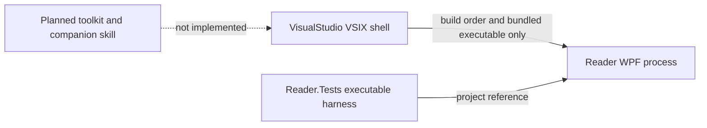

# Code summary

VsCopilotChatVoice is an independent Visual Studio Copilot Chat voice integration under
development. Its .NET Framework 4.8 solution contains a thin AsyncPackage VSIX, a separate
x64 WPF/System.Speech reader, and an executable reader regression harness.

## Components

The 0.2.3 VSIX previews three disabled, flat toolbar icons beside Customize AI inside one
themed border, using conservative WPF discovery. It does not launch the reader or provide a
command bridge. Initial 0.2.0 attachment was verified; the user confirmed grouped icons look
fine and approved the tighter 24-DIP group-height correction in Exp. The full native
theme/DPI/accessibility and chat-recreation matrix remains pending.
No VoiceType source or engine/model assets have been copied.
The reader retains prototype branding and a pale-yellow palette.

The 0.2.7 diagnostic build retains that toolbar appearance and adds `ChatBridgePoc`, explicitly
gated to Debug + Exp + launch environment opt-in. Its current-user-only named pipe only inspects
live WPF binding metadata plus one level of the observed Session/Composer/ChatLog bindings;
it cannot insert/send or deliver replies. Production plans in
IMPLEMENTATION_PLAN.md supersede optional-VoiceType-app discovery with selective external-host
source reuse and move only reader presentation into a native VS tool window; neither is migrated.

## Structural symbols

### VsCopilotChatVoice.VisualStudio

| Symbol | File | Responsibility |
| --- | --- | --- |
| `VsCopilotChatVoice.VisualStudio.VoicePackage` | `src\VsCopilotChatVoice.VisualStudio\VoicePackage.cs` | Background-loadable package; owns/disposes toolbar integration and provides dynamic VS resource references and activity logging. |
| `ChatToolbarIntegration` | `src\VsCopilotChatVoice.VisualStudio\ChatToolbarIntegration.cs` | Bounded visible-picker discovery, conservative placement, disabled accessible controls, duplicate/lifetime handling; no speech or SDK dependencies. |
| `ChatBridgePoc` | `src\VsCopilotChatVoice.VisualStudio\ChatBridgePoc.cs` | Opt-in Exp-only read-only pipe; bounded WPF control discovery and binding/identity metadata inspection. No production input/reply protocol. |

### VsCopilotChatVoice.Reader

All reader symbols retain the `ReadAlongTrial` namespace.

| Symbol | File | Responsibility |
| --- | --- | --- |
| `Program` | `src\VsCopilotChatVoice.Reader\ReaderPrototype.cs` | STA entry point, ordered CLI validation, live owner HWND validation, self-tests. |
| `ReaderWindow` | `src\VsCopilotChatVoice.Reader\ReaderPrototype.cs` | Reader UI, playback lifetime, highlighting, Follow and version switching. |
| `DocumentBuilder` / `ReplyBlock` | `src\VsCopilotChatVoice.Reader\ReaderPrototype.cs` | JSON block validation, display/spoken document construction and cross-version section matching. |
| `ReadingNavigation` / `ReadingPosition` | `src\VsCopilotChatVoice.Reader\ReaderPrototype.cs` | Sentence/paragraph movement and text-pointer seeking. |
| `Segment` / `WordAnchor` | `src\VsCopilotChatVoice.Reader\ReaderPrototype.cs` | Section identity and spoken-offset-to-display mapping. |
| `ReplyVersionPreference` | `src\VsCopilotChatVoice.Reader\ReaderPrototype.cs` | Immediate, atomic Concise/Detailed preference persistence. |

### VsCopilotChatVoice.Reader.Tests

| Symbol | File | Responsibility |
| --- | --- | --- |
| `ReadAlongNavigationTests` | `tests\VsCopilotChatVoice.Reader.Tests\ReaderRegressionTests.cs` | Executable WPF/navigation/preference/ownership and child-process regression checks; no Test Explorer adapter. |
| `ToolbarRegressionTests` | `tests\VsCopilotChatVoice.Reader.Tests\ToolbarRegressionTests.cs` | Optional reflection-based checks against the actual VSIX toolbar class using offscreen synthetic WPF chat controls; no speech/preferences. |
| `BridgePocRegressionTests` | `tests\VsCopilotChatVoice.Reader.Tests\BridgePocRegressionTests.cs` | Optional actual-VSIX checks for gating, metadata, public/interface identity fields, private/content getter exclusion and hidden windows, plus isolated real-listener timeout/recovery/shutdown checks. No VS input/speech/preferences. |

See `docs/KEY_FLOWS.md` for traced end-to-end call flows.

Build/test commands, reply data contract and verified Exp installation steps are in `README.md`.