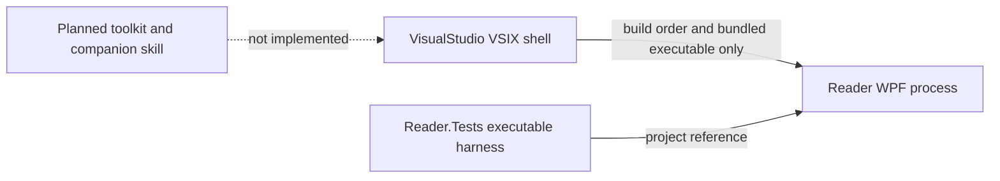

# Code summary

VsCopilotChatVoice is an independent Visual Studio Copilot Chat voice integration under
development. Its .NET Framework 4.8 solution contains a thin AsyncPackage VSIX, a separate
x64 WPF/System.Speech reader, and an executable reader regression harness.

## Components

The 0.2.3 VSIX previews three disabled, flat toolbar icons beside Customize AI inside one
themed border, using conservative WPF discovery. It does not launch the reader or provide a
command bridge. Initial 0.2.0 attachment was verified; the user confirmed grouped icons look
fine and approved the tighter 24-DIP group-height correction in Exp. The full native
theme/DPI/accessibility and chat-recreation matrix remains pending.
No VoiceType source or engine/model assets have been copied.
The reader retains prototype branding and a pale-yellow palette.

The 0.2.12 PoC build retains that toolbar appearance and adds `ChatBridgePoc`, explicitly
gated to Debug + Exp + launch environment opt-in. Its current-user-only named pipe defaults to inspecting
live WPF metadata through observed Session/Composer/ChatLog and composer-input/action paths,
plus inspected typed session-ID fields and passive draft-revision/trust/responding observation;
an additional launch gate accepts insertion-capability requests through `ChatDraftPoc` but always
refuses unproved native atomic editing. The unfenced draft getter/setter transaction was removed.
It cannot send or deliver replies. Production plans in
IMPLEMENTATION_PLAN.md supersede optional-VoiceType-app discovery with selective external-host
source reuse and move only reader presentation into a native VS tool window; neither is migrated.

The 0.3.0 PoC 2 build adds a native floating tool window (View > Other Windows > Copilot Voice
Reader (Preview)) with an external headless speech worker. devenv hosts presentation only; the worker
is the bundled `VsCopilotChatVoice.Reader.exe --speech-worker <pipe>`, talking JSON lines over a
current-user-only named pipe. The shared protocol/host files in `src\Shared` are compiled into the
VSIX, the Reader and the test project. This is a preview proof, not the production reader.

## Structural symbols

### VsCopilotChatVoice.VisualStudio

| Symbol | File | Responsibility |
| --- | --- | --- |
| `VsCopilotChatVoice.VisualStudio.VoicePackage` | `src\VsCopilotChatVoice.VisualStudio\VoicePackage.cs` | Background-loadable package; owns/disposes toolbar integration and provides dynamic VS resource references and activity logging. |
| `ChatToolbarIntegration` | `src\VsCopilotChatVoice.VisualStudio\ChatToolbarIntegration.cs` | Bounded visible-picker discovery, conservative placement, disabled accessible controls, duplicate/lifetime handling; no speech or SDK dependencies. |
| `ChatBridgePoc` | `src\VsCopilotChatVoice.VisualStudio\ChatBridgePoc.cs` | Opt-in Exp pipe, bounded native target discovery and separately gated atomic-insertion capability refusal. No draft mutation or send/reply protocol. |
| `ChatTargetObservation` | `src\VsCopilotChatVoice.VisualStudio\ChatTargetObservation.cs` | Passive native-target epoch and draft-notification counter, trust/responding streams, automatic terminal teardown and primitive diagnostic retention. Does not read/write a draft or invoke commands. |
| `ChatDraftPoc` | `src\VsCopilotChatVoice.VisualStudio\ChatDraftPoc.cs` | Explicit unsupported-atomic-edit refusal, bounded request validation, cancellation, non-evicting request deduplication and immutable-slot metadata checks; no draft access or send. |

| `ReaderToolWindow` | `src\VsCopilotChatVoice.VisualStudio\ReaderToolWindow.cs` | `ToolWindowPane` registered `Style=Float`; hosts the control and disposes it. |
| `ReaderToolWindowControl` | `src\VsCopilotChatVoice.VisualStudio\ReaderToolWindowControl.cs` | Code-built WPF: Speak/Cancel, status, sample reply, VS-themed word highlight, lazy worker launch, UI-thread generation guard. No speech in-process. |
| `VoiceCommands.vsct` | `src\VsCopilotChatVoice.VisualStudio\VoiceCommands.vsct` | View > Other Windows menu command that shows the tool window. |

### Shared (compiled into VSIX, Reader and Tests)

| Symbol | File | Responsibility |
| --- | --- | --- |
| `SpeechWorkerProtocol` / `WorkerMessage` / `BoundedLineReader` / `ReplyText` | `src\Shared\SpeechWorkerProtocol.cs` | Message DTO, size limits, strict parser, bounded line reader and the word/offset model. |
| `SpeechWorkerHost` | `src\Shared\SpeechWorkerHost.cs` | Pipe server, single active generation, worker PID check, fault handling, background-thread teardown. |

### VsCopilotChatVoice.Reader

All reader symbols retain the `ReadAlongTrial` namespace.

| Symbol | File | Responsibility |
| --- | --- | --- |
| `Program` | `src\VsCopilotChatVoice.Reader\ReaderPrototype.cs` | STA entry point, ordered CLI validation, live owner HWND validation, self-tests. |
| `ReaderWindow` | `src\VsCopilotChatVoice.Reader\ReaderPrototype.cs` | Reader UI, playback lifetime, highlighting, Follow and version switching. |
| `DocumentBuilder` / `ReplyBlock` | `src\VsCopilotChatVoice.Reader\ReaderPrototype.cs` | JSON block validation, display/spoken document construction and cross-version section matching. |
| `ReadingNavigation` / `ReadingPosition` | `src\VsCopilotChatVoice.Reader\ReaderPrototype.cs` | Sentence/paragraph movement and text-pointer seeking. |
| `Segment` / `WordAnchor` | `src\VsCopilotChatVoice.Reader\ReaderPrototype.cs` | Section identity and spoken-offset-to-display mapping. |
| `ReplyVersionPreference` | `src\VsCopilotChatVoice.Reader\ReaderPrototype.cs` | Immediate, atomic Concise/Detailed preference persistence. |
| `SpeechWorker` | `src\VsCopilotChatVoice.Reader\SpeechWorker.cs` | Headless pipe client (`--speech-worker <pipe> [--silent]`): speaks, reports progress, ignores events from superseded prompts. |

### VsCopilotChatVoice.Reader.Tests

| Symbol | File | Responsibility |
| --- | --- | --- |
| `ReadAlongNavigationTests` | `tests\VsCopilotChatVoice.Reader.Tests\ReaderRegressionTests.cs` | Executable WPF/navigation/preference/ownership and child-process regression checks; no Test Explorer adapter. |
| `ToolbarRegressionTests` | `tests\VsCopilotChatVoice.Reader.Tests\ToolbarRegressionTests.cs` | Optional reflection-based checks against the actual VSIX toolbar class using offscreen synthetic WPF chat controls; no speech/preferences. |
| `BridgePocRegressionTests` | `tests\VsCopilotChatVoice.Reader.Tests\BridgePocRegressionTests.cs` | Optional actual-VSIX checks for gating, metadata, public/interface identity fields, private/content getter exclusion and hidden windows, plus isolated real-listener timeout/recovery/shutdown checks. No VS input/speech/preferences. |
| `SpeechWorkerRegressionTests` | `tests\VsCopilotChatVoice.Reader.Tests\SpeechWorkerRegressionTests.cs` | `--speech-worker-probe`: protocol, word model, fake and real silent worker (progress/cancel/replace), fault paths, disposal. 51 assertions. |
| `DraftPocRegressionTests` | `tests\VsCopilotChatVoice.Reader.Tests\DraftPocRegressionTests.cs` | Actual-VSIX mutation-surface removal, capability refusal, validation, cancellation, deduplication/conflicts/capacity and immutable-slot checks; no live VS input. |

See `docs/KEY_FLOWS.md` for traced end-to-end call flows.

Build/test commands, reply data contract and verified Exp installation steps are in `README.md`.