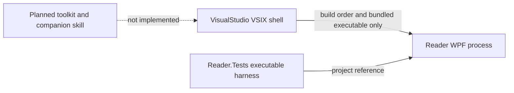

# Code summary

VsCopilotChatVoice is an independent Visual Studio Copilot Chat voice integration under
development. Its .NET Framework 4.8 solution contains a thin AsyncPackage VSIX, a separate
x64 WPF/System.Speech reader, and an executable reader regression harness.

## Components

The VSIX currently logs initialization only; it neither launches the bundled reader nor
injects chat controls. VoiceType is a separate optional future backend, not a dependency
copied into this solution. The reader retains prototype branding and a pale-yellow palette.

## Structural symbols

### VsCopilotChatVoice.VisualStudio

| Symbol | File | Responsibility |
| --- | --- | --- |
| `VsCopilotChatVoice.VisualStudio.VoicePackage` | `src\VsCopilotChatVoice.VisualStudio\VoicePackage.cs` | Background-loadable package; writes the foundation initialization activity-log entry. |

### VsCopilotChatVoice.Reader

All reader symbols retain the `ReadAlongTrial` namespace.

| Symbol | File | Responsibility |
| --- | --- | --- |
| `Program` | `src\VsCopilotChatVoice.Reader\ReaderPrototype.cs` | STA entry point, ordered CLI validation, live owner HWND validation, self-tests. |
| `ReaderWindow` | `src\VsCopilotChatVoice.Reader\ReaderPrototype.cs` | Reader UI, playback lifetime, highlighting, Follow and version switching. |
| `DocumentBuilder` / `ReplyBlock` | `src\VsCopilotChatVoice.Reader\ReaderPrototype.cs` | JSON block validation, display/spoken document construction and cross-version section matching. |
| `ReadingNavigation` / `ReadingPosition` | `src\VsCopilotChatVoice.Reader\ReaderPrototype.cs` | Sentence/paragraph movement and text-pointer seeking. |
| `Segment` / `WordAnchor` | `src\VsCopilotChatVoice.Reader\ReaderPrototype.cs` | Section identity and spoken-offset-to-display mapping. |
| `ReplyVersionPreference` | `src\VsCopilotChatVoice.Reader\ReaderPrototype.cs` | Immediate, atomic Concise/Detailed preference persistence. |

### VsCopilotChatVoice.Reader.Tests

| Symbol | File | Responsibility |
| --- | --- | --- |
| `ReadAlongNavigationTests` | `tests\VsCopilotChatVoice.Reader.Tests\ReaderRegressionTests.cs` | Executable WPF/navigation/preference/ownership and child-process regression checks; no Test Explorer adapter. |

See `docs/KEY_FLOWS.md` for traced end-to-end call flows.

Build/test commands, reply data contract and verified Exp installation steps are in `README.md`.